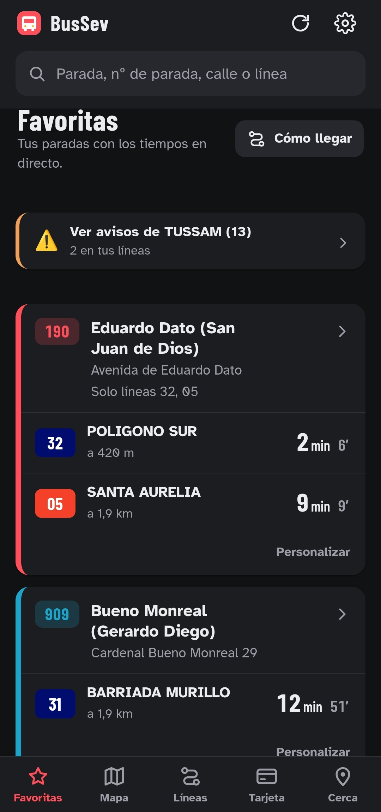
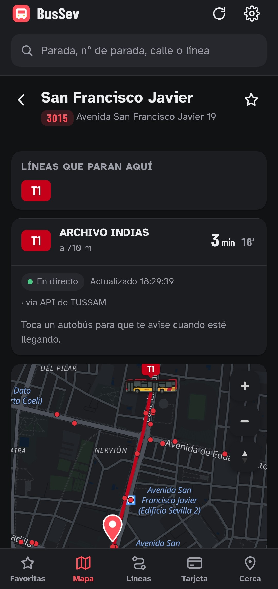
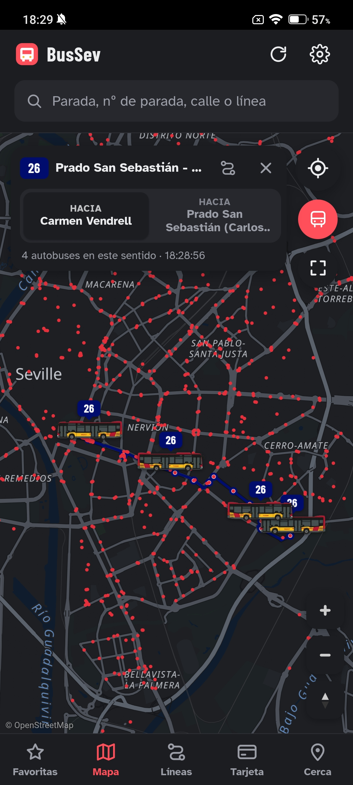
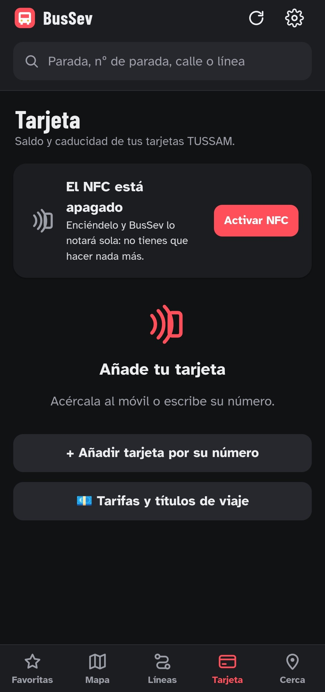

# BusSev 🚌

**BusSev** es una app para Android para moverte en los autobuses de **TUSSAM** (Sevilla).
Te dice cuánto le falta a tu autobús, dónde va cada uno en el mapa (siguiendo las calles de verdad),
cuánto saldo tiene tu tarjeta y los avisos de desvíos y obras. Es gratis, no tiene anuncios y no te pide registrarte.

> BusSev es un proyecto personal e independiente. **No es la app oficial de TUSSAM** ni tiene relación con TUSSAM.
> Los datos los saca de las webs y los datos abiertos públicos de TUSSAM y del Ayuntamiento de Sevilla,
> igual que harías tú con el navegador.

<!-- 📸 CAPTURAS: ponlas en la carpeta docs/capturas/ del repositorio. Donde veas una línea
     , sube tu imagen con ese mismo nombre y aparecerá sola.
     Puedes cambiar los nombres o quitar las que no quieras. -->

---

## ¿Qué puedo hacer con BusSev?

### ⭐ Favoritas
Guarda las paradas que más usas y ve de un vistazo cuánto le falta a cada autobús.
- **Tiempos en directo** de cada línea, con el siguiente autobús y a qué distancia va.
- Ordénalas como quieras (ves al momento en qué puesto queda la parada) y **agrúpalas** por títulos («Casa», «Trabajo»…).
- Arriba te avisa de lo que importa hoy: **buses nocturnos**, **servicios especiales** (Feria, Semana Santa),
  **festivos**, **saldo bajo** o **tarjeta a punto de caducar**, y si estás **sin conexión**.
- Botón de **avisos de TUSSAM** que afectan a tus líneas, y el aviso dentro de cada parada a la que le toca.

#### 🎨 Personalizar cada parada (con vista previa en directo, a pantalla completa)
- **Aspecto**: nombre propio, **icono** (casa, trabajo, cole, universidad, médico, compras, deporte, café, comer, ocio,
  parque, iglesia, estación, aeropuerto, centro, familia, favorita), **color** y **11 estilos de tarjeta**:
  Clásico, Teñido, Degradado, Contorno, Neón, Cristal, Panel de parada, Azulejo, Retro, Semana Santa y Feria.
- **Qué mostrar**: tarjeta **compacta** (una sola línea con el próximo bus), **ocultar la dirección**,
  **«Llegando» animado**, y elegir **qué líneas** ver en esa parada.
- **Orden**: grupo y posición en la lista.

### 🚏 Parada
- Arriba: el nombre, tu nombre para ella, el **número de poste** y las **líneas que paran** (tócalas para ver su recorrido).
- Botones **Personalizar** (o Guardar) · **Cómo llegar** · **Avisar**.
- **Filtro de líneas** para ver solo la que te interesa.
- **Minutos** que le faltan a cada línea y **avísame cuando llegue**: elige el autobús y te avisa con una
  notificación (con el sonido que elijas), aunque tengas la app cerrada.
- **📳 Modo sensor**: te guardas el móvil y vibra según se acerca tu autobús, sin mirar la pantalla. Empieza cuando
  faltan 5 minutos y da un aviso por minuto cada vez más fuerte (un toque suave, dos, tres, uno largo y, al llegar,
  uno muy fuerte). En Android 16 los minutos salen también como un chip en la barra de arriba.
- Si TUSSAM no da tiempos, te enseña los **próximos según el horario oficial**.
- **Horario en esta parada**: todos los pasos del día de cada línea, según el horario oficial (GTFS).
- **Mapa** con la parada, los autobuses que vienen y el camino que les queda (también en pantalla completa).
- Avisos de TUSSAM que afectan a la parada y si es **accesible** para silla de ruedas (♿).

### 🧭 Cómo llegar
Te dice qué coger para ir de un sitio a otro: **directo o con transbordo**, ordenado por la hora a la que llegas.
- Busca **calles con número de portal**, **sitios** (hospitales, centros comerciales, estaciones…), **paradas** o
  tu ubicación. Guarda los **sitios recientes**.
- **Combinar con** (se activa en casillas, apagado de serie): **Metro** (Línea 1), **Cercanías Renfe** (C1 a C5) y
  **bici Sevici** (con las bicis y los huecos libres en ese momento).
- Cada opción explica los tramos andando, en bus, metro o tren, con horas de salida y llegada.
- **Avísame al bajar**: sigue tu viaje con el GPS y te avisa una parada antes de la tuya.

### 🗺️ Mapa
- Todas las paradas de Sevilla. Toca una línea y verás su **recorrido real por las calles** y
  **los autobuses que van por ella ahora mismo**, moviéndose solos y mirando hacia donde van.
- Capas opcionales (apagadas de serie, en *Ajustes → Mapa*): **Metro de Sevilla**, **Cercanías Renfe** con sus
  estaciones y próximos trenes, y **estaciones Sevici** con bicis y huecos libres en directo.
- Estilo de mapa, nombres de calles, paradas y recorridos se pueden encender o apagar.

> El recorrido de cada línea es el **trazado oficial** que publica el Ayuntamiento de Sevilla en datos abiertos,
> así que el autobús va por su calle de verdad, no en línea recta entre paradas.

> TUSSAM no publica el GPS de sus autobuses: BusSev calcula dónde está cada uno a partir de la distancia
> que da TUSSAM. Es una posición **aproximada**, pero muy cercana a la real.

### 🔎 Buscador
En la barra de arriba, en cualquier pantalla, busca **por número de poste**, **por nombre de la parada o la calle**
o **por línea**. Los resultados salen al momento mientras escribes.

### 🛣️ Líneas
- Todas las líneas, con filtro de nocturnas.
- Lista de paradas de cada línea con el **tiempo de llegada** de los autobuses al lado de cada parada
  y las demás líneas que paran en ella.
- Si una línea tiene un **desvío** por obras o un evento, te lo avisa con enlace al aviso.

### 📍 Cerca
Las paradas que tienes cerca y cuánto le falta a cada autobús. Si tienes la ubicación apagada, te avisa al momento.

### 💳 Tarjeta
- **Acerca tu tarjeta TUSSAM al móvil** (NFC) y BusSev la reconoce, o escribe su número.
- Ve su **saldo**, tipo, caducidad y **cuántos viajes te quedan** (con el precio actual de TUSSAM).
- Guarda varias tarjetas y ordénalas (y elige cuál es la primera).
- **Avisos**: te avisa si te queda poco saldo o si la tarjeta va a caducar.
- **Tarifas y títulos de viaje** actualizados desde la web de TUSSAM.

#### 🎨 Personalizar cada tarjeta (con vista previa en directo, a pantalla completa)
- **Tarjeta**: nombre, **icono** (tarjeta, autobús, persona, familia, casa, trabajo, estudios, compras, deporte, ocio,
  favorita), **color**, **ocultar el número** (solo se ven los 4 últimos) y **efecto brillo** al mover el móvil.
- **Diseño**: 10 dibujos de Sevilla — La Giralda, Torre del Oro, Puente de Triana, Azulejo, Plaza de España,
  Las Setas, Farolillos, Caseta de Feria, Paso de palio y Nazarenos — o **una foto tuya** de fondo.
- **Marco**: dorado, plateado, bronce, oro rosa, arcoíris, neón, doble blanco, azulejo, lunares, cordón morado
  y madera. Cada marco se ve ya puesto sobre tu tarjeta con su dibujo o su foto.

### ⚠️ Avisos de TUSSAM
Desvíos, obras y horarios especiales (con sus **PDF e imágenes**). BusSev los revisa al abrirse y te manda una
notificación si hay uno nuevo en las líneas de tus paradas favoritas. Puedes elegir dónde verlos: en Favoritas,
en cada parada favorita, al abrir una parada o al abrir una línea.

### 📲 Widget de inicio
Pon una parada en la **pantalla de inicio** del móvil y ve los próximos autobuses sin abrir la app.
Elige qué líneas ver y, al tocarlo, se abre directo en esa parada.

### ✈️ Sin conexión
Si te quedas sin datos, BusSev te sigue enseñando los **últimos tiempos que tenía** (avisándote de que no están al día),
el horario oficial y la información de paradas y líneas, que va guardada dentro de la app.

### ⚙️ Ajustes y a tu gusto
- Tema claro u oscuro, **color de la app** (incluidos pasteles) y **color de fondo**.
- **Icono de la app** a elegir: Clásico, Noche, Azulejo, Feria, Semana Santa, Giralda y Verde.
  (Al cambiarlo, Android quita el acceso de la pantalla de inicio y hay que volver a ponerlo: te avisa antes.)
- **Sonido del aviso de llegada**: campanas, ding-dong, marimba o estación (se repite 3 veces), con botón para probarlo.
- **Cielo de Sevilla** (opcional, se enciende en Ajustes): la barra de arriba se pinta con el cielo real de Sevilla — amanecer, día,
  atardecer o noche con estrellas y la luna en su fase — y nubes o lluvia si las hay (previsión de Open-Meteo).
- **Temáticas** que cambian solas: Navidad, Semana Santa, Feria y Halloween, con adornos y, si quieres,
  **pasos, coches de caballos o carrozas** en el mapa en vez de autobuses.
- Cada cuánto **se actualizan los tiempos** y si ver los **autobuses en directo** en el mapa.
- **Accesibilidad**: **modo sencillo** (solo lo esencial y botones grandes), tamaño del texto, botones más grandes,
  alto contraste, menos animaciones, vibración y **lectura en voz alta** (también al abrir una parada).
- **Copia de seguridad** de favoritas y tarjetas para pasarlas a otro móvil.
- **Actualizaciones**: busca, descarga e instala la versión nueva desde la propia app, y te enseña sus novedades.

---

## Cómo instalarla

BusSev no está en Google Play: se instala con un archivo **APK** (el instalador de apps de Android).

1. **Descarga el APK.** Desde el móvil, entra en la página de *Releases* del proyecto
   (te pasarán el enlace) y toca **BusSev.apk**.
2. **Ábrelo.** Cuando termine la descarga, toca el archivo (en la notificación o en *Descargas*).
3. **Permite la instalación.** La primera vez, Android te dirá que no se pueden instalar apps de esa fuente.
   Toca **Ajustes**, activa **Permitir de esta fuente** y vuelve atrás.
4. Toca **Instalar**. Si sale un aviso de *Play Protect* diciendo que la app no es conocida,
   toca **Más detalles → Instalar de todas formas**. Sale porque la app no viene de Google Play, no porque tenga nada malo.
5. ¡Listo! Ya tienes BusSev en tu pantalla de inicio.

**Para actualizarla**, ve a *Ajustes → Actualizaciones → Buscar actualización*, o descarga el APK nuevo,
e instálalo **encima**: no pierdes tus favoritas ni tus tarjetas. BusSev también te avisa sola cuando hay una versión nueva.

### Permisos que te puede pedir
| Permiso | Para qué | ¿Obligatorio? |
|---|---|---|
| **Ubicación** | Paradas cerca, Cómo llegar desde donde estás y «Avísame al bajar» | No: solo cuando usas esas funciones |
| **NFC** | Leer tu tarjeta TUSSAM al acercarla | No: también puedes escribir el número |
| **Notificaciones** | Avisos de llegada, de bajada, de saldo bajo y de TUSSAM | No |

Para leer la tarjeta, el **NFC del móvil tiene que estar encendido**. Si está apagado, BusSev te lleva al ajuste con un botón.

---

## Preguntas frecuentes

**¿Es segura?**
Sí. BusSev solo se conecta con las webs de TUSSAM, el mapa (OpenStreetMap), el buscador de direcciones
(CartoCiudad y Photon), el tiempo de Sevilla para el cielo (Open-Meteo) y, si lo activas, los datos de Sevici (CityBikes). No tiene anuncios ni rastreadores,
no guarda tus datos en ningún servidor y todo se queda en tu móvil. No pide tu cuenta de TUSSAM.

**¿Gasta mucha batería o datos?**
No. Solo consulta a TUSSAM mientras miras la pantalla, guarda las respuestas unos segundos para no repetir
consultas y se para cuando la app está en segundo plano.

**¿Por qué a veces no salen los tiempos?**
Los tiempos vienen de TUSSAM. Si su servicio falla, BusSev reintenta sola, te enseña los últimos datos que tenía
(avisándote de que no están al día) y se actualiza sola cuando vuelve la conexión.

**¿Por qué no sale el saldo de mi tarjeta Solidaria?**
TUSSAM no muestra en su web el saldo de las tarjetas que no se recargan por internet. BusSev te enseña lo que
sí da: el número y la caducidad.

**¿Puedo ver mis viajes (cuándo he picado)?**
No. TUSSAM no publica ese historial en su web pública.

**¿Puedo hacer una copia de mis favoritas y tarjetas?**
Sí: *Ajustes → Tus datos → Copia de seguridad*. Te sirve para pasarlas a otro móvil.

---

### El recorrido de las líneas en el mapa
El trazado que se dibuja en el mapa se calcula al compilar (`scripts/recorridos.mjs`) y se guarda en `www/recorridos.js`.
Para cada línea se usa, por orden:
1. **Trazado oficial de TUSSAM** (datos abiertos del Ayuntamiento de Sevilla, capa «TUSSAM_Lineas»), en `geojson/lineas.json`.
   Es la geometría real por calle de (casi) todas las líneas: la fuente más fiable y completa (`scripts/recorridos_tussam.mjs`).
2. **OpenStreetMap** (relaciones `route=bus`) para lo que no esté en el dato oficial (`scripts/recorridos_osm.mjs`, vía Overpass).
3. **OSRM** (rutas por calle de OpenStreetMap) como último recurso.

Si alguna parada de un extremo o de en medio cae lejos del trazado oficial (porque el dato va por una calle paralela),
ese tramo concreto se enlaza siguiendo las calles con OSRM, con línea recta solo como último respaldo. Así ninguna
parada queda suelta y nada se dibuja por encima de las casas.

**Se actualiza solo:** `scripts/actualizar_datos.sh` descarga en cada compilación el trazado oficial más reciente del
portal de datos abiertos. Si TUSSAM cambia el recorrido de una línea, la siguiente compilación lo coge solo; si el portal
no responde, se usa el `geojson/lineas.json` que lleva el repositorio. Para forzar otro origen hay un secreto opcional
`TUSSAM_LINEAS_ITEM` (el identificador del item en ArcGIS Online).

### Paradas y recorridos: se actualizan solos
Los horarios oficiales de TUSSAM (GTFS) se descargan **solos** cada vez que GitHub compila la app
(`scripts/actualizar_datos.sh`), de dos fuentes por orden:
1. El **Punto de Acceso Nacional** del Ministerio de Transportes (donde los publica TUSSAM).
2. **Mobility Database**, que es una copia del anterior.

Solo se usan si el archivo está completo y es igual o más reciente que el que ya hay; si no, se queda el anterior
y la compilación sigue. Los datos nuevos (y el trazado oficial) también se guardan en el repositorio.

Además, **cada lunes** GitHub mira si TUSSAM, Metro o Renfe han publicado horarios o recorridos nuevos (por ejemplo,
cuando una línea cambia de recorrido) y, solo si los hay, compila una versión nueva por su cuenta. Si no hay nada
nuevo no compila, así que no se llena *Releases* de copias. Las calles de OpenStreetMap se revisan una vez al mes.
Estas revisiones se mantienen encendidas solas: GitHub apaga las tareas programadas tras 60 días sin actividad, y
cada revisión las vuelve a encender.

> Los **tiempos en directo** no dependen de esto: salen de TUSSAM en el momento, así que un cambio de recorrido
> se nota en los minutos desde el primer día. Lo que se actualiza con la revisión es el trazado en el mapa,
> el horario oficial de cada parada y Cómo llegar.

### Metro, Cercanías y Sevici
- **Metro de Sevilla**: horarios oficiales (GTFS del Punto de Acceso Nacional), convertidos al compilar en `www/metro.js`
  (`scripts/actualizar_metro.sh`).
- **Cercanías Renfe**: GTFS de Renfe, convertido al compilar en `www/cercanias.js` (`scripts/actualizar_cercanias.sh`).
- **Sevici**: bicis y huecos libres en directo desde la API pública de CityBikes, solo mientras miras el mapa o
  pides una ruta con bici (como mucho una vez cada 90 segundos).
- Metro, Cercanías y el horario de cada parada se cargan solo cuando hacen falta, para que la app arranque rápido.

### Iconos de la app
Los iconos alternativos (Android) y sus miniaturas de Ajustes salen del mismo dibujo: `python3 scripts/iconos_app.py`.

### Servidor propio (opcional)
En `servidor-saldo/` hay un servidor pequeño (Deno Deploy gratis, o Google Cloud Run) que lee el **saldo** de la tarjeta.
Se activa en *Ajustes → Tus datos → Tu servidor*.

También sabe pedir los tiempos de llegada, pero **normalmente TUSSAM no le deja**: su web de tiempos está protegida con
Cloudflare y a los servidores de internet les pide una comprobación de navegador («Just a moment», error 403).
Por eso esa opción viene desactivada y los tiempos se piden desde el móvil. El servidor tiene un diagnóstico en
`/diag/249` que dice qué contesta TUSSAM.

### Número de versión
El nombre de la versión (v1.1.2, v1.1.3…) está en el archivo **`VERSION`** del repositorio: cámbialo cuando quieras
estrenar versión. Cada compilación lleva además un número interno que siempre sube (el contador de GitHub + 100), que es
el que deja instalar la nueva encima. Si vuelves a compilar la misma versión, su publicación en *Releases* se sustituye.

### Botón «Buscar actualización»
Al compilar, GitHub apunta el número de versión en `www/version.js`. La app pregunta a GitHub cuál es la última
versión publicada. Si el repositorio es **privado**, GitHub no deja mirarlo sin entrar: la app abre la página de versiones
para que entres con tu cuenta.

### Créditos
- La forma de pedir y leer los tiempos de llegada (y las rutas internas `/paradas/…/tiempos`, `/cercanas`…) está basada en
  la **[API TUSSAM](https://github.com/686f6c61/API-TUSSAM)** de 686f6c61, publicada con licencia
  [PolyForm Noncommercial 1.0.0](https://polyformproject.org/licenses/noncommercial/1.0.0) (Copyright (c) 2026 686f6c61).
  Por eso BusSev también es **solo para uso no comercial**. BusSev no usa su servidor: pregunta a TUSSAM desde el móvil.
- Horarios, paradas y accesibilidad de las paradas: GTFS oficial de TUSSAM (Punto de Acceso Nacional).
- **Recorrido de las líneas por calle: trazado oficial de TUSSAM en datos abiertos del Ayuntamiento de Sevilla**
  (IDE Sevilla / cda-idesevilla), capa «TUSSAM_Lineas».
- Posición exacta de las paradas y recorridos de respaldo: © colaboradores de [OpenStreetMap](https://www.openstreetmap.org/copyright)
  (ODbL), consultados al compilar con Overpass y OSRM (`scripts/paradas_osm.mjs`, `scripts/recorridos_osm.mjs` y `scripts/recorridos.mjs`).
- Mapa: OpenFreeMap / OpenStreetMap.

### Aviso legal
Uso **personal y no comercial**. Proyecto independiente, sin relación con TUSSAM. Los servicios de TUSSAM no son
públicos ni están documentados: si cambian, alguna función puede dejar de ir hasta que se ajuste la app.
